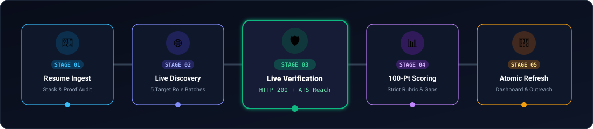
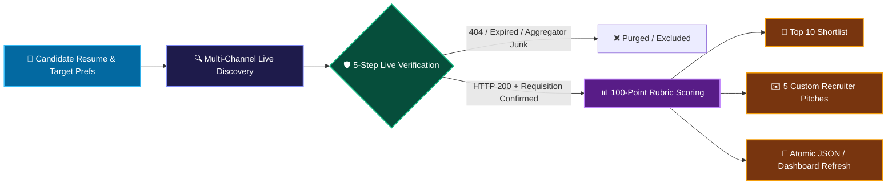

<div align="center">

<!-- Animated Header Banner -->


<br/>

# ⚡ Daily Verified Job Search
### *Autonomous, Evidence-Backed Career Discovery & Real-Time ATS Link Verification for Every AI*

<br/>

<!-- Dynamic Shield Badges -->
<p align="center">
  <a href="#-universal-ai-deployment-guide"></a>
  <a href="#-the-anti-hallucination-verification-protocol"></a>
  <a href="#-100-point-algorithmic-fit-matrix"></a>
  <a href="#-automated-cron--refresh-schedule"></a>
  <a href="LICENSE"></a>
</p>

<p align="center">
  <b>Supports:</b>
  <code>Claude Code / Opus 4.5</code> •
  <code>ChatGPT / GPT-4o / o3</code> •
  <code>Google Antigravity &amp; Gemini</code> •
  <code>Cursor / Windsurf / Cline</code> •
  <code>Manus AI</code> •
  <code>DeepSeek / Open-Source LLMs</code>
</p>

---

### 🌐 [Quick Jump]
[Why This Skill?](#-why-this-skill) •
[Interactive Pipeline](#-interactive-verification-pipeline) •
[Universal AI Setup](#-universal-ai-deployment-guide) •
[100-Point Scoring](#-100-point-algorithmic-fit-matrix) •
[Zero-Hallucination Rules](#-the-anti-hallucination-verification-protocol) •
[JSON Output Playground](#-json-output-playground) •
[Recruiter Message Engine](#-tailored-recruiter-outreach-engine)

---

</div>

<br/>

## 🎯 Why This Skill?

Traditional AI job hunting suffers from **three massive fatal flaws**:
1. 🛑 **Hallucinated URLs:** Standard LLMs invent plausible URLs (`company.com/careers/swe-2026`) that lead to 404s.
2. 👻 **Ghost & Stale Listings:** Scraped aggregators often feature jobs filled 6 months ago.
3. 🎲 **Vague Keyword Matching:** Generic prompts match keywords without evaluating actual candidate proof, technical depth, or eligibility constraints.

> **The Daily Verified Job Search Skill changes the paradigm.**  
> It turns any tool-using AI model into a rigorous, evidence-driven career agent that **refuses to hallucinate**, queries live career pages and ATS endpoints (Greenhouse, Lever, Workday, Ashby, SmartRecruiters), enforces a **100-point algorithmic match rubric**, and atomically purges stale listings every single morning.

<br/>

---

## 🚀 Interactive Verification Pipeline

Every search passes through a strict 5-stage verification funnel before reaching your shortlist:

<div align="center">
  
</div>

<br/>



<br/>

---

## 🤖 Universal AI Deployment Guide
### *Works Firmly on ANY AI Agent, Environment, or Platform*

Choose your environment below to activate the skill immediately:

<details open>
<summary><b>🟣 1. Universal One-Click Prompt (Works in ANY AI: ChatGPT, Grok, Claude Web, Perplexity, DeepSeek)</b></summary>

<br/>

Copy and paste this universal prompt into your chat session along with your resume:

```markdown
You are now operating under the "Daily Verified Job Search" skill protocol.

Follow these inviolable rules:
1. Treat my attached resume and target preferences as the absolute source of truth.
2. Search CURRENT web pages in real-time. Never rely on remembered training listings or search snippet assumptions.
3. Every job MUST be independently verified:
   - Live listing page confirmed open and current.
   - Application destination confirmed reachable (Official ATS like Greenhouse, Lever, Workday, Ashby, or official careers email).
4. Strictly exclude expired, duplicate, suspicious, mislocated, or senior-only roles.
5. Apply the 100-Point Fit Scoring Rubric:
   - 30 pts: Direct tech stack overlap
   - 20 pts: Seniority & location/student eligibility
   - 20 pts: Demonstrated project/work proof
   - 15 pts: Core fundamentals & interview readiness
   - 10 pts: Domain & product relevance
   - 5 pts: Success likelihood / absence of blocker gaps
6. Group findings into:
   - "Apply First" (85–100)
   - "Good Match" (70–84)
   - "Stretch Role" (50–69)
7. Output the standardized JSON schema with candidate summary, verified active jobs, verification evidence, and top 5 custom recruiter outreach messages.
8. NEVER fabricate a link, salary, or recruiter identity. State "not stated" if unknown. Do NOT apply on my behalf without explicit approval.

My Preferences:
- Target Geography / Work Mode: [e.g., Remote / Bengaluru, India / Hybrid]
- Target Seniority: [e.g., Entry-level / Fresher / SDE-1 / Mid-level]
- Number of Recommended Role Families: 5

[Attach or Paste Resume Here]
```

</details>

<details>
<summary><b>🔵 2. Google Antigravity & Gemini CLI (AGY Native Skill)</b></summary>

<br/>

If you are using Google Antigravity (AGY) or Gemini CLI:

1. **Auto-Discovery:**  
   Place `daily-verified-job-search.skill` (or `SKILL.md`) in your project root or `~/.gemini/antigravity/skills/daily-verified-job-search/SKILL.md`.
2. **Invoke in Chat:**
   ```bash
   /goal Refresh my daily verified job search based on my resume in ./resume.pdf
   ```
3. **Autonomous Execution:**  
   The agent reads the instructions directly from `SKILL.md` and uses the native browser/search tools to crawl, test HTTP links, calculate fit scores, and populate your job dashboard.

</details>

<details>
<summary><b>🟣 3. Anthropic Claude (Claude Code, Desktop Projects & Coworker)</b></summary>

<br/>

1. **Claude Projects / Coworker:**  
   Upload `SKILL.md` as a Project Knowledge file. Set the Project Instructions to:
   > *"When prompted with 'run job search' or a resume, execute the Daily Verified Job Search skill defined in Project Knowledge."*
2. **Claude Code CLI:**  
   Run:
   ```bash
   claude "Analyze my resume at ./resume.pdf and execute the daily-verified-job-search skill using web search to find 10 live verified roles."
   ```

</details>

<details>
<summary><b>🟢 4. OpenAI ChatGPT & Custom GPTs</b></summary>

<br/>

1. In your **Custom GPT Builder**, upload `SKILL.md` under **Knowledge**.
2. Enable **Web Browsing & Code Interpreter**.
3. Under **Instructions**, insert:
   > *"You are the Daily Verified Job Search Specialist. Follow the operating rules, verification constraints, 100-point rubric, and JSON output schema in SKILL.md for all job queries."*

</details>

<details>
<summary><b>💻 5. Cursor, Windsurf, Cline & VS Code Agents</b></summary>

<br/>

1. Copy `SKILL.md` into your repository root or under `.cursorrules` / `.clinerules`.
2. In your composer / chat pane, invoke:
   ```text
   @SKILL.md @resume.pdf Find 10 verified live jobs matching my profile. Test all URLs before writing output.
   ```

</details>

<details>
<summary><b>🌐 6. Manus AI & Autonomous Web Agents</b></summary>

<br/>

Manus supports full browser execution:
1. Provide `SKILL.md` as the system instruction.
2. Instruct Manus:
   > *"Search live job boards, open each listing in the browser, confirm the apply button works, verify the ATS host, and output `jobs_database.json`."*

</details>

<br/>

---

## 📊 100-Point Algorithmic Fit Matrix

This skill evaluates candidates with mathematical precision, stripping out recruiter fluff:

| Category | Max Pts | Evaluation Criteria | Deduction Triggers |
| :--- | :---: | :--- | :--- |
| **Technical Stack Overlap** | **30** | Direct match between candidate languages, frameworks, databases, and core technologies listed in requirements. | -5 for each missing core technology; -15 if primary backend/frontend language differs. |
| **Seniority & Eligibility** | **20** | Precise alignment with YOE (Years of Experience), graduation year, fresher status, location, and work authorization. | -20 if role mandates 3+ YOE for a fresher; -10 if relocation required without sponsorship. |
| **Demonstrated Proof** | **20** | Live deployed projects, GitHub repositories, production deployments, measurable metrics, or open-source pull requests. | -10 if project claims lack verifiable link or repository proof. |
| **Core Fundamentals** | **15** | Data Structures & Algorithms, system design foundations, testing disciplines, CI/CD, and interview readiness. | -5 for absence of testing/debugging competencies. |
| **Domain & Product Fit** | **10** | Industry familiarity (e.g. Fintech, AI/ML, SaaS, Developer Tools, E-Commerce). | -5 if company operates in niche domain requiring specialized compliance/protocols. |
| **Success Likelihood** | **5** | Holistic evaluation of mandatory non-negotiables (security clearance, degree requirements). | Drops to 0 and caps overall score if any mandatory non-negotiable is missing. |

### 🏷️ Scoring Classifications
```
┌─────────────────────────────────────────────────────────────┐
│ 🟢 Apply First   (85–100 Pts) : High probability; instant priority. │
│ 🟡 Good Match    (70–84 Pts)  : Strong fit with minor skill gaps.  │
│ 🟣 Stretch Role  (50–69 Pts)  : High upside; requires strategic resume.│
│ 🔴 Disqualified  (< 50 Pts)   : Missing mandatory blockers; excluded. │
└─────────────────────────────────────────────────────────────┘
```

<br/>

---

## 🛡️ The Anti-Hallucination Verification Protocol

Every AI using this skill is bound by **inviolable operating laws**:

```
 [START]
    │
    ▼
 [Step 1: Check Live Listing HTTP 200]
    ├── Status != 200 / Redirected to Home ────────► ❌ REJECT & EXCLUDE
    └── Status == 200 (Active)
         │
         ▼
 [Step 2: Inspect Application Destination]
    ├── Aggregator Click-Farm / Broken Link ──────► ❌ REJECT & EXCLUDE
    └── Direct Career Portal / Verified ATS (Lever, Greenhouse, Workday, etc.)
         │
         ▼
 [Step 3: Verification Evidence Stamping]
    └── Record Exact Timestamp, Source Type, and Active Status
         │
         ▼
 [Step 4: Atomic Shortlist Inclusion]
```

- [x] **Zero Remembered Listings:** AI cannot use training memory; must query live web tools.
- [x] **ATS Destination Check:** Application URL must terminate at a legitimate employer portal or verified ATS.
- [x] **No Ghost Data:** If salary, equity, or recruiter is missing, output `"not stated"`—**never guess**.
- [x] **Consent Gate:** AI prepares applications and outreach drafts, but **never automatically submits or sends messages without human approval**.

<br/>

---

## 📦 JSON Output Playground

The skill outputs clean, machine-readable JSON ready for dashboards, automated feeds, or static sites:

```json
{
  "lastRefreshedAt": "2026-11-09T09:00:00+05:30",
  "candidate": {
    "name": "Alex Mercer",
    "seniority": "Entry-Level / Fresher (2025 Grad)",
    "targetRoles": [
      "Junior Backend Engineer (Python/Go)",
      "Full-Stack Developer (React/Node)",
      "Cloud & DevOps Associate",
      "AI/ML Systems Engineer",
      "Software Engineer - Platform"
    ],
    "strengths": ["FastAPI", "PostgreSQL", "Docker", "Distributed Systems projects"],
    "gaps": ["Kubernetes in production", "Microservices at enterprise scale"]
  },
  "jobs": [
    {
      "id": "stripe-swe1-blr-2026",
      "title": "Software Engineer I - Infrastructure",
      "company": "Stripe",
      "location": "Bengaluru, India (Hybrid)",
      "experienceRequired": "0-2 Years",
      "summary": "Build high-throughput payment rails and reliable distributed storage systems.",
      "listingUrl": "https://stripe.com/jobs/listing/infra-swe-1",
      "applyUrl": "https://boards.greenhouse.io/stripe/jobs/4829104",
      "sourceType": "official-ats",
      "verifiedCurrent": true,
      "verifiedAt": "2026-11-09T08:52:14+05:30",
      "verificationEvidence": "HTTP 200 confirmed on Greenhouse board; requisition active; apply form responsive.",
      "category": "Apply First",
      "fitScore": 94,
      "whyMatch": "Candidate's flagship async payment simulator directly mirrors Stripe's distributed idempotency requirements.",
      "missingSkills": "Ruby on Rails (easily learned on the job).",
      "priorityRank": 1,
      "resumeImprovements": [
        "Elevate throughput benchmark (5,000 req/sec) to the top bullet in the Projects section."
      ]
    }
  ],
  "topFiveRecruiterMessages": [
    {
      "jobId": "stripe-swe1-blr-2026",
      "message": "Hi [Recruiter Name], I saw Stripe's opening for SWE I (Infra) on Greenhouse (Req #4829104). I recently engineered an open-source distributed idempotency ledger in Go/PostgreSQL benchmarking 5k RPS. Given Stripe's focus on fault tolerance, I'd welcome the chance to share my technical writeup. Best, Alex."
    }
  ]
}
```

<br/>

---

## ✉️ Tailored Recruiter Outreach Engine

Finding the listing is only half the battle. This skill crafts **high-conversion, non-spammy direct pitches** customized to each verified job:

```
┌────────────────────────────────────────────────────────────────────────┐
│  RECRUITER OUTREACH ARCHITECTURE                                      │
├────────────────────────────────────────────────────────────────────────┤
│  1. Exact Role & Requisition ID anchor (proves you did your homework)  │
│  2. Single strongest high-impact technical proof point from resume     │
│  3. Frictionless call-to-action (shares code / portfolio, no begging)  │
└────────────────────────────────────────────────────────────────────────┘
```

<br/>

---

## ⏰ Automated Cron & Refresh Schedule

To receive fresh, verified jobs every morning in your inbox or dashboard:

### 🕒 Recommended Cron Configuration
* **Target Time:** Every day at **09:00 AM IST** (03:30 AM UTC)
* **Standard 5-Field Cron:** `30 3 * * *`
* **6-Field (Quartz / Enterprise):** `0 30 3 * * ?`
* **Antigravity / Local India Cron:** `0 0 9 * * *` (Timezone: `Asia/Kolkata`)

### 🐙 Ready-to-Run GitHub Action
This repository includes a plug-and-play workflow located at:  
👉 [`.github/workflows/daily-job-search.yml`](.github/workflows/daily-job-search.yml)

Trigger it manually via **Workflow Dispatch** or let it execute automatically every morning!

<br/>

---

## 📁 Repository Structure

```text
├── .github/
│   └── workflows/
│       └── daily-job-search.yml       # Automated Daily 9:00 AM IST Scheduler
├── assets/
│   ├── banner.svg                     # Animated Glowing Vector Banner
│   └── pipeline.svg                   # Animated 5-Stage Verification Funnel
├── daily-verified-job-search.skill    # Portable Bundled Agent Skill Package
├── SKILL.md                           # Universal AI Execution Specification
└── README.md                          # Interactive Documentation
```

<br/>

---

## 🤝 Contributing & Community

Contributions are warmly welcomed! If you would like to:
* Add custom ATS parsers (Ashby, Workday, Greenhouse).
* Enhance the 100-point rubric with industry-specific modules.
* Build frontend visual dashboards for `jobs_database.json`.

Please feel free to open a Pull Request or file an Issue!

<br/>

<div align="center">

**Built with ❤️ for every AI agent and career explorer.**  
*Never waste time on expired listings again.*

[](#)

</div>

